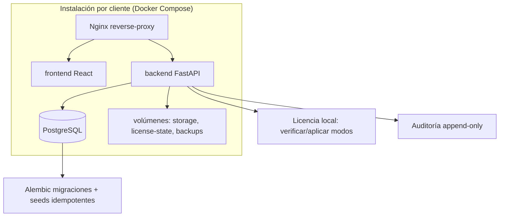

# PLAN — 001-FUNDACION

| Campo | Valor |
|---|---|
| Iniciativa | 001-fundacion |
| Versión | 1.0 |
| Fecha | 2026-08-03 |
| Responsable | Arquitecto de software / Arquitecto empresarial |
| Ruta | `specs/001-fundacion/plan.md` |

## 1. Validación contra la Constitución

| Principio | Cumplimiento |
|---|---|
| P1 Spec antes que código | ✔ Este plan no ejecuta implementación |
| P2 Autorización expresa | ✔ Se detiene en `/speckit.analyze` |
| P3 Trazabilidad | ✔ `traceability-matrix.md` |
| P4 Núcleo fiscal separado | ✔ Estructura de módulos con `fiscal` separado |
| P5 Datos históricos protegidos | ✔ Modelo con estados/inmutabilidad |
| P6 Seguridad en backend | ✔ Backend autoridad |
| P7 Frontend uniforme | ✔ Sistema de diseño obligatorio |
| P8 No hardcodear reglas | ✔ Reglas versionadas |
| P9 Instalación independiente | ✔ Docker Compose por cliente |
| P10 Calidad demostrable | ✔ Plan de pruebas |
| P11 Accesibilidad/responsive | ✔ Frontend foundation |
| P12 Decisiones documentadas | ✔ ADR |
| P13 Integridad transaccional | ✔ data-model |
| P14 Infraestructura reproducible | ✔ Compose + migraciones + seeds |
| P15 Datos del cliente protegidos | ✔ license-foundation |
| P16 Gestión de versiones | ✔ lockfiles, imágenes fijadas |
| P17 No retrabajo visual | ✔ Componentes compartidos |
| P18 Política de modales | ✔ Frontend foundation |
| P19 Reglas normativas versionadas | ✔ authority-matrix |
| P20 No sustitución de organismos | ✔ Fuera de alcance |

**Resultado: el plan es compatible con la Constitución.**

## 2. Arquitectura de solución

Monolito modular desplegable por contenedores. La separación modular existe en código, servicios, datos, contratos, permisos, eventos, pruebas y documentación.



### Servicios Compose (fundacionales)

| Servicio | Imagen/Origen | Persistencia | Health check | Notas |
|---|---|---|---|---|
| `frontend` | Build multi-stage (Node → Nginx) | No persistente | `curl /healthz` | SPA servida por Nginx |
| `backend` | Build multi-stage (Python 3.13) | Archivos temporales | `/api/v1/health/live` | Uvicorn; no root |
| `db` | `postgres:18` (fijada por digest) | Volumen obligatorio | `pg_isready` | Usuario restringido; sin exposición pública |
| `reverse-proxy` | `nginx` (línea estable fijada) | No persistente | TCP check | TLS, headers, SPA |
| `worker` | **No en 001** (ADR-009 aplazado) | — | — | Tareas programadas vía scheduler del sistema en 001 |

Volúmenes nominales: `kontrol-db-data`, `kontrol-storage`, `kontrol-license-state`, `kontrol-backups`.

## 3. Estructura del repositorio (definitiva para 001)

```text
kontrol/
├── kontrol.py                  # CLI de instalación y operación (kontrol)
├── compose.yaml                # Producción
├── compose.dev.yaml            # Desarrollo
├── .env.example
├── .gitignore
├── .dockerignore
├── resources/
│   ├── frontend/
│   │   ├── src/app/            # providers, router, shell
│   │   ├── src/modules/        # módulos por dominio
│   │   ├── src/components/     # componentes compartidos
│   │   ├── src/design-system/  # tokens y primitivas
│   │   ├── src/api/            # cliente OpenAPI generado
│   │   ├── src/lib/            # utilidades controladas
│   │   └── src/tests/
│   └── backend/
│       ├── app/
│       │   ├── core/           # config, seguridad, db, licencia
│       │   ├── modules/        # dominios
│       │   ├── shared/         # errores, auditoría, reportes
│       │   └── main.py
│       ├── alembic/
│       └── tests/
├── specs/
├── requerimientos/
├── docs/
├── scripts/                    # backup, restore, diagnóstico, update
├── storage/                    # documentos persistentes
├── backups/
└── databases/                  # volumen PostgreSQL local (dev)
```

## 4. Módulos de backend (fundacionales y separados)

| Módulo | Responsabilidad en 001 |
|---|---|
| `core` | Configuración, seguridad (Argon2id, tokens, cookies), base de datos, licencia, request ID, errores |
| `modules/organization` | Installation, Tenant, Company, Branch, Establishment, Warehouse, Location |
| `modules/identity_access` | User, Role, Permission, RolePermission, UserRole, UserScope, Session, PasswordReset, MFA preparado |
| `modules/audit` | AuditEvent append-only |
| `modules/licensing` | LicenseState, LicenseInstallation, importación/verificación de licencia, modos de acceso |
| `modules/documents` | FileMetadata, hash, almacenamiento básico |
| `modules/fiscal` (preparación) | LegalSource, TaxRuleVersion, FiscalNumberSeries, ControlNumberBatch (estructura; sin emisión) |
| `modules/system` | SystemSetting, FeatureFlag, IdempotencyRecord, OutboxEvent |

## 5. Frontend (fundacional)

- App Shell, Sidebar, Topbar, PageLayout, PageHeader, PageContent, Breadcrumbs, PageActions.
- Router con guards (RouteGuard, PermissionGuard, LicenseGate) y ErrorBoundary.
- Estados: Loading, Empty, NoResults, Error, Forbidden, NotFound, Conflict, ReadOnly.
- Diseño: tokens (color, tipografía Ubuntu, espaciado 4px, radios, sombras, z-index, tamaños, breakpoints), Lucide React.
- Estado: TanStack Query (keys por dominio/empresa), React Hook Form, Zod.
- Autenticación: cookies HttpOnly para refresh; access token en memoria; CSRF.
- Componentes obligatorios (ver `frontend-foundation.md` y DOC-08 §20).

## 6. Datos y migraciones

- PostgreSQL como única fuente de verdad.
- Alembic: migraciones revisadas, upgrade/downgrade, expand/contract, backfill validado.
- Seeds idempotentes separadas de datos legales configurables.
- Modelo detallado en `data-model.md`.

## 7. Contratos

- Contrato de error uniforme.
- OpenAPI publicado por FastAPI; cliente TypeScript generado (sin DTO duplicado manual).
- Contratos iniciales en `contracts/`.

## 8. Seguridad (resumen)

- Argon2id; cookies HttpOnly/Secure/SameSite; CSRF; CORS restrictivo; TLS; headers de seguridad; rate limiting; usuario PostgreSQL restringido; secretos fuera del repo; SBOM; escaneo de secretos. Detalle en `security-baseline.md`.

## 9. Licenciamiento local (resumen)

- Identidad persistente; verificación de firma; cálculo de modo; bloqueo de escrituras en READ_ONLY; Mi licencia; carga de comprobante. Detalle en `license-foundation.md`.

## 10. Pruebas

Plan completo en `test-plan.md`. Resumen: unitarias (backend/frontend), componentes, integración API/PostgreSQL, E2E (trayectoria fundacional), infraestructura (Compose, persistencia, backup/restore), accesibilidad.

## 11. CI/CD y puertas de calidad

Pipeline propuesto: lint (frontend/backend), type check, tests, build, migraciones, contratos, E2E, accesibilidad, dependencias, escaneo de secretos, Docker scan, SBOM, cobertura, evidencias. No merge sin Spec aprobada, checklist, trazabilidad, ausencia de secretos/vulnerabilidades críticas.

## 12. Riesgos principales

| Riesgo | Control |
|---|---|
| Versiones no verificadas | Research + validación en CI antes de fijar lockfiles |
| Normativa no validada | `LEGAL_VALIDATION_REQUIRED`; revisión por abogado/contador antes de producción |
| Retrabajo visual | Sistema de diseño + componentes compartidos obligatorios |
| Aislamiento multiempresa | tenant/company en cada agregado + pruebas negativas |
| Licencia evadida por reloj | Fecha confiable persistente + evaluación en cada escritura |
| Secreto en repo | Escaneo de secretos en CI + `.gitignore` |

## 13. Fases de implementación de la iniciativa (para `/speckit.implement`)

1. Fundación del repositorio (estructura, CLI, compose, entornos, gitignore).
2. Backend core (config, db, errores, request ID, seguridad).
3. Modelo de datos + migraciones + seeds.
4. Identidad de instalación y licencia local.
5. Organización e identity_access.
6. Auditoría.
7. Frontend design system + App Shell + rutas + guards.
8. Módulos frontend fundacionales (organización, seguridad, licencia, inicio).
9. Contratos OpenAPI y cliente generado.
10. Scripts de operación (backup, restore, diagnóstico, update).
11. Pruebas unitarias/integración/E2E/infraestructura.
12. CI/CD y puertas de calidad.
13. Documentación y evidencia.

## 14. Entregables de esta fase documental

Este plan forma parte del paquete de la fase documental de `001-fundacion` y **no autoriza implementación**; la implementación requiere `/speckit.analyze` consistente y autorización expresa.

## 15. Estado de aprobación

| Elemento | Estado |
|---|---|
| Arquitectura | ✔ |
| Estructura | ✔ |
| Módulos | ✔ |
| Datos | ✔ (data-model.md) |
| Seguridad | ✔ (security-baseline.md) |
| Licencia | ✔ (license-foundation.md) |
| Pruebas | ✔ (test-plan.md) |
| Aprobación | Pendiente |
