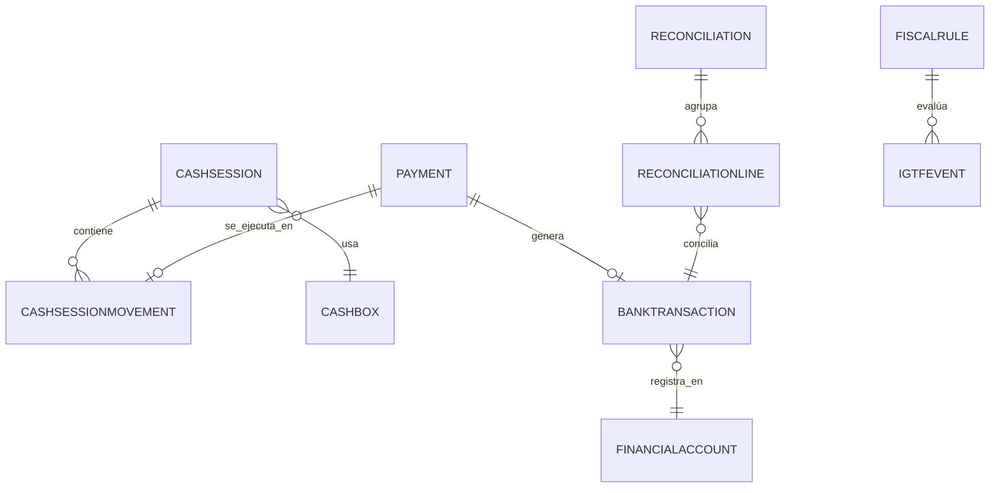

# MODELO DE DATOS — 006-TESORERIA

| Campo | Valor |
|---|---|
| Iniciativa | 006-tesoreria |
| Versión | 1.0 |
| Fecha | 2026-08-04 |
| Ruta | `specs/006-tesoreria/data-model.md` |

> Convenciones: `PK` clave primaria, `FK` clave foránea, `UQ` único, `IX` índice, `DEC(x,y)` decimal exacto, `JSON` campos estructurados (SQLite tests). Aislamiento multiempresa por `company_id`. Auditoría en todas las tablas (`created_at/updated_at/created_by/updated_by`, `row_version`).

## 1. Maestros financieros (prerequisito — DOC-02 §3)

| Tabla | Campos | Notas |
|---|---|---|
| `financial_banks` | PK id, company_id UQ, code, name, swift, country, status, JSON policies | Bancos |
| `financial_accounts` | PK id, company_id UQ, bank_id FK, code UQ, name, currency, iban, reference, status | Cuentas bancarias |
| `cashboxes` | PK id, company_id UQ, code, name, currency, warehouse_id FK nullable, status, JSON policies | Cajas; reutiliza almacenes opcional |
| `payment_methods` | PK id, company_id UQ, code, name, kind (CASH/BANK/OTHER), status | Métodos (efectivo, cheque, transferencia…) |
| `payment_instruments` | PK id, company_id UQ, method_id FK, code, name, cashbox_id/account_id nullable, status | Instrumentos |
| `currencies` | PK id, company_id UQ, code, name, symbol, decimal_places | Monedas (maestro) |
| `exchange_rates` | PK id, company_id, currency_id FK, rate_date, rate DEC(18,8), source | Tasas históricas (snapshot por transacción) |

## 2. Cajas — sesiones y movimientos (DOC-03 §9 / DOC-02 §10)

| Tabla | Campos | Notas |
|---|---|---|
| `cash_sessions` | PK id, company_id, cashbox_id FK, opened_by FK users, opened_at, closed_at, opened_amount DEC, counted_amount DEC, difference DEC, status (OPEN/ARCHED/PRE_CLOSED/CLOSED/REJECTED), JSON audit | FR-006-001 |
| `cash_session_movements` | PK id, session_id FK, movement_type (IN/OUT/ADJUST), payment_id FK nullable (004), amount DEC, instrument_id FK nullable, reference, note, status | Movimientos de la sesión |

## 3. Bancos — transacciones (DOC-03 §9)

| Tabla | Campos | Notas |
|---|---|---|
| `bank_transactions` | PK id, company_id, account_id FK, txn_date, value_date, direction (IN/OUT), amount DEC, currency, reference, source (PAYMENT/COLLECTION/TRANSFER/DEPOSIT/ADJUSTMENT), payment_id FK nullable, commission DEC nullable, status | FR-006-010 |
| `treasury_transfers` | PK id, company_id, from_cashbox_id/from_account_id nullable, to_cashbox_id/to_account_id nullable, amount DEC, currency, value_date, reference, status | Transferencias/depósitos FR-006-023 |

## 4. Conciliación (DOC-03 §9 / DOC-02 §10)

| Tabla | Campos | Notas |
|---|---|---|
| `reconciliations` | PK id, company_id, account_id FK, statement_date, statement_ref, opening_balance DEC, closing_balance DEC, status (DRAFT/IN_PROGRESS/REVIEW/APPROVED/REJECTED), approved_by, approved_at | FR-006-031 |
| `reconciliation_lines` | PK id, reconciliation_id FK, bank_transaction_id FK, system_movement_id (payment/collection), match_score DEC, matched_by (RULE/MANUAL), rule_id FK nullable, status, JSON resolution | Resolución auditada FR-006-030 |

## 5. IGTF por regla y evento (DOC-02 §10 / FR-006-040/041)

| Tabla | Campos | Notas |
|---|---|---|
| `fiscal_rules` | PK id, company_id, rule_code UQ, name, rule_type (IGTF/WITHHOLDING), version, effective_from, effective_to, params JSON (rate, thresholds), status | Reglas versionadas; motor completo en 007 |
| `igft_events` | PK id, company_id, event_type (PAYMENT/COLLECTION/TRANSFER), source_document, amount DEC, currency, rate_snapshot DEC, igft_amount DEC, rule_id FK, evaluated_at, status | Evaluación por evento; no confundir con IVA |

## 6. Reutilización (sin redefinir)

| Origen | Entidad | Uso en 006 |
|---|---|---|
| 004 | `ap_payments` / `ap_payment_instruments` | Egresos: ejecución contra caja/banco (direction OUT) |
| 005 | `sales` (pagos/cobros IN) | Ingresos: ejecución y conciliación |
| 004/005 | `ap_open_items` | Aplicación de anticipos/pagos |
| 002 | `parties`, `users`, `warehouses` | Referencias |

## 7. Diagrama de relaciones (resumen)

## 8. Notas de diseño

- Los saldos de caja/banco **se calculan** desde movimientos y cierres; no se editan (P5).
- Cada transacción conserva **snapshot de moneda y tasa histórica** (FR-006-052).
- Idempotencia en POST críticos (FR-006-100).
- Decimal exacto `DEC` en montos; `DEC(18,8)` en tasas.
