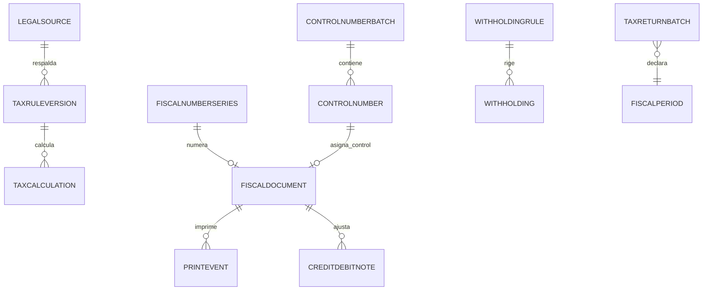

# MODELO DE DATOS — 007-NUCLEO-FISCAL

| Campo | Valor |
|---|---|
| Iniciativa | 007-nucleo-fiscal |
| Versión | 1.0 |
| Fecha | 2026-08-04 |
| Ruta | `specs/007-nucleo-fiscal/data-model.md` |

> Convenciones: `PK` clave primaria, `FK` clave foránea, `UQ` único, `IX` índice, `DEC(x,y)` decimal exacto, `JSON` campos estructurados (SQLite tests). Aislamiento multiempresa por `company_id`. Auditoría en todas las tablas. `lock_version` para asignación atómica.

## 1. Reglas y perfiles fiscales (DOC-03 §10)

| Tabla | Campos | Notas |
|---|---|---|
| `legal_sources` | PK id, company_id UQ, authority, source_type, number, gazette, publication_date, effective_from/to, file_ref, hash, status | FR-007-002 |
| `tax_rule_versions` | PK id, company_id UQ, tax_code, tax_type (IVA/WITHHOLDING_IVA/ISLR/IGTF), legal_source_id FK, effective_from/to, params JSON (rate, formula, minimum, subtractor), approval JSON, fiscal_release, status | Reglas versionadas; sin solape (FR-007-001) |
| `tax_profiles` | PK id, company_id UQ, scope (COMPANY/PARTY/ITEM), party_id FK nullable, item_id FK nullable, classifications JSON, validity, source, status | FR-007-003 |
| `tax_calculations` | PK id, company_id, document_ref, line_ref, rule_version_id FK, base, rate, amount, rounding, snapshot JSON | FR-007-004 |

## 2. Numeración y números de control (DOC-03 §7/§12)

| Tabla | Campos | Notas |
|---|---|---|
| `fiscal_number_series` | PK id, company_id UQ, establishment, document_type, prefix, next_number, lock_version, validity, status | Correlativos atómicos `UQ(company, establishment, document_type)` (FR-007-010) |
| `control_number_batches` | PK id, company_id, establishment, printer, range_from, range_to, received_at, status, counts JSON | Lotes de imprenta (FR-007-011) |
| `control_numbers` | PK id, company_id, batch_id FK, value, state (AVAILABLE/RESERVED/USED/VOID/LOST/DAMAGED), document_ref, timestamps | `UQ(batch, value)`; un documento activo no comparte control (FR-007-012) |

## 3. Emisión, impresión y notas (DOC-03 §7)

| Tabla | Campos | Notas |
|---|---|---|
| `fiscal_documents` | PK id, company_id, business_document (INVOICE:xxx), document_type, fiscal_mode, series, invoice_number, control_number, fiscal_currency, exchange_rate_snapshot, emitted_at, hash, status | Envuelve documentos de 004/005; inalterable (FR-007-021) |
| `print_events` | PK id, company_id, fiscal_document_id FK, copy_type, printer, user_id, printed_at, reason, hash | Impresión/reimpresión auditada (FR-007-022) |
| `credit_debit_notes` | PK id, company_id, fiscal_document_id FK, original_document (factura), cause, limits JSON, inventory_effect, financial_effect, status | Notas con límites al saldo ajustable (FR-007-030) |

## 4. Retenciones (DOC-03 §10/§13)

| Tabla | Campos | Notas |
|---|---|---|
| `withholding_rules` | PK id, company_id, tax_type (IVA/ISLR), concept, code, conditions JSON, base, rate, minimum, subtractor, validity, status | FR-007-040 |
| `withholdings` | PK id, company_id, party_id FK, source_event, documents JSON, rule_id FK, calculation JSON, certificate_ref, period, status | Ciclo: CALCULATED→APPROVED→PRACTICED→CERTIFICATE_ISSUED→DECLARED→PAID→RECONCILED; REVERSED (FR-007-041) |

## 5. Períodos, declaraciones y libros

| Tabla | Campos | Notas |
|---|---|---|
| `fiscal_periods` | PK id, company_id, tax_type, start, end, deadlines JSON, status (OPEN/CLOSED/REOPENED), approvals JSON | Cierre/reapertura aprobados (FR-007-051) |
| `tax_return_batches` | PK id, company_id, tax_type, period, files JSON, totals JSON, submission, payment, reconciliation, status | FR-007-052 |
| Libros | **Vista reconstruible** (no tabla): consulta sobre fiscal_documents + tax_calculations + withholdings + igft_events por período | Reconstruibles, no editables (FR-007-050) |

## 6. Reutilización (sin redefinir)

| Origen | Entidad | Uso en 007 |
|---|---|---|
| 004/005 | `SalesInvoice` / `SupplierInvoice` / notas | Envuelto por `FiscalDocument` / `CreditDebitNote` |
| 004/005 | `Withholding` (ap/ventas) | Retenciones practicadas/sufridas → ciclo 007 |
| 006 | `IgftEvent` | Eventos IGTF para libros/declaraciones (CL-007-09) |
| 002 | `parties` | Perfiles fiscales por tercero |

## 7. Diagrama de relaciones (resumen)

## 8. Notas de diseño

- Numeración/control con **asignación atómica** bajo `lock_version`/transacción (FR-007-010/020).
- `hash` SHA-256 sobre contenido canónico; esquema versionado (SU-007-02).
- Los libros se sirven bajo demanda; nunca se materializan en tablas editables (P5).
- Decimal exacto `DEC` en bases/montos; tasas `DEC(18,8)`.
