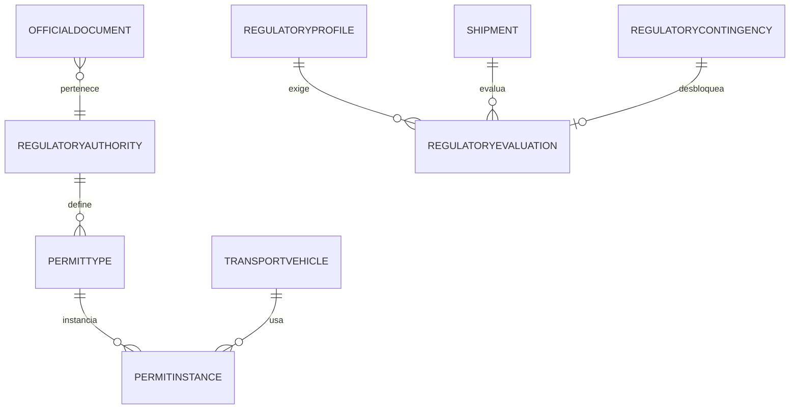

# MODELO DE DATOS — 008-REGULACION-TRASLADOS

| Campo | Valor |
|---|---|
| Iniciativa | 008-regulacion-traslados |
| Versión | 1.0 |
| Fecha | 2026-08-04 |
| Ruta | `specs/008-regulacion-traslados/data-model.md` |

> Convenciones: `PK` clave primaria, `FK` clave foránea, `UQ` único, `IX` índice, `JSON` campos estructurados (SQLite tests). Aislamiento multiempresa por `company_id`. Auditoría en todas las tablas.

## 1. Maestros regulatorios (DOC-01 §7 / DOC-02 §3 / DOC-03 §11)

| Tabla | Campos | Notas |
|---|---|---|
| `regulatory_authorities` | PK id, company_id UQ, code, name (SENIAT, SUNAGRO, INSAI, SACS…), validation_method, status | FR-008-001 |
| `permit_types` | PK id, company_id UQ, authority_id FK, code, name, scope, validation_method, status | FR-008-002 |
| `official_registrations` | PK id, company_id, authority_id FK, scope (COMPANY/PARTY/SITE/VEHICLE/PERSON), ref_number, issued/expiry dates, file_ref, status | FR-008-003 |
| `regulatory_profiles` | PK id, company_id UQ, rubric_id FK nullable, product_id nullable, operation, origin/destination, required_documents JSON, validity, version, status | FR-008-005 |
| `transport_vehicles` | PK id, company_id UQ, plate, type, capacity, owner_party_id FK, documents JSON, status | FR-008-004 |
| `transport_drivers` | PK id, company_id UQ, party_id FK, license, documents JSON, status | FR-008-004 |

## 2. Permisos y guías (DOC-03 §11/§13 / DOC-01 §10)

| Tabla | Campos | Notas |
|---|---|---|
| `permit_instances` | PK id, company_id, permit_type_id FK, number, issued_at, expires_at, origin/destination, products JSON, lots JSON, quantity, vehicle_id FK, file_ref, hash, verification, status | Ciclo: DRAFT→REGISTERED→VERIFIED→APPROVED_FOR_USE→USED→EXPIRED; REJECTED/CANCELLED (FR-008-010/011) |
| `official_documents` | PK id, company_id, kind (SICA/GUIA_FISCAL/SIGESAI/SACS/OTRO), authority_id FK, number, organism, issued_at, expires_at, file_ref, hash, verification, status | Guías registradas/validadas, no fabricadas (FR-008-012/013) |

## 3. Evaluación y bloqueo del despacho (DOC-03 §11 / DOC-01 §10)

| Tabla | Campos | Notas |
|---|---|---|
| `regulatory_evaluations` | PK id, company_id, shipment_id FK (005), shipment_line_ref, profile_version_id FK nullable, required JSON, results JSON, blockers JSON, override JSON, status | Evaluación por línea (FR-008-020/021) |
| `approval_requests` | PK id, company_id, object_ref, rule_ref, requester_id, approvers JSON, risk, amount, deadline, decision, status | FR-008-025 |

## 4. Contingencias (DOC-01 §10)

| Tabla | Campos | Notas |
|---|---|---|
| `regulatory_contingencies` | PK id, company_id, rule_ref, reason, allowed_by, started_at, ended_at, status | Solo con regla oficial versionada (FR-008-030) |

## 5. Reutilización (sin redefinir)

| Origen | Entidad | Uso en 008 |
|---|---|---|
| 005 | `Shipment` / `ShipmentLine` | Objeto de la evaluación y bloqueo (FR-008-032) |
| 001 | `companies`, `warehouses`, `locations` | Origen/destino y aislamiento |
| 002 | `parties`, `catalog_items` (rubros) | Perfiles regulatorios y vehículos |
| 003 | `inventory` (lotes/seriales) | Coincidencia producto/lote/cantidad en el bloqueo |

## 6. Diagrama de relaciones (resumen)

## 7. Notas de diseño

- Los permisos y guías conservan `hash` y auditoría; no se eliminan (P5).
- La evaluación por línea consolida requisitos; el bloqueo es por regla (FR-008-022).
- Las contingencias exigen regla oficial versionada (FR-008-030).
- Decimal exacto en cantidades/montos; `JSON` para documentos requeridos.
