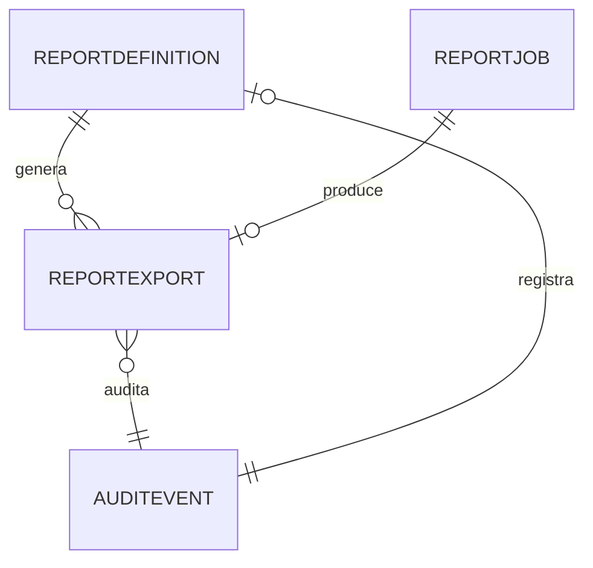

# MODELO DE DATOS — 009-REPORTES-AUDITORIA

| Campo | Valor |
|---|---|
| Iniciativa | 009-reportes-auditoria |
| Versión | 1.0 |
| Fecha | 2026-08-04 |
| Ruta | `specs/009-reportes-auditoria/data-model.md` |

> Convenciones: `PK` clave primaria, `FK` clave foránea, `IX` índice, `JSON` campos estructurados (SQLite tests). Aislamiento multiempresa por `company_id`. Auditoría en todas las tablas.

## 1. Entidades nuevas (009)

| Tabla | Campos | Notas |
|---|---|---|
| `report_exports` | PK id, company_id, report_key, format (CSV/PDF), filters JSON, file_ref, exported_by, exported_at, status | **Auditoría de exportación** (FR-009-020) |
| `report_jobs` | PK id, company_id, report_key, params JSON, status (PENDING/RUNNING/DONE/FAILED), error, started_at, finished_at, created_by | Trabajos asíncronos (FR-009-023) |
| `report_definitions` | PK id, company_id UQ, report_key, name, category (EXECUTIVE/OPERATIONAL/FINANCIAL/FISCAL/REGULATORY), enabled | Catálogo (opcional) |

## 2. Reutilización (sin redefinir)

| Origen | Entidad | Uso en 009 |
|---|---|---|
| 001 | `AuditEvent` | Timeline de auditoría (FR-009-022) |
| 003 | `InventoryBalance`/`InventoryMovement` | Reportes operativos |
| 004 | `ap_open_items`, `ap_payments` | CxP aging / financiero |
| 005 | `SalesInvoice`, `SalesOrder`, `Shipment` | Ventas / operativos / regulatorio |
| 006 | `BankTransaction`, `CashSession` | Tesorería |
| 007 | Libros reconstruibles | Reportes fiscales |
| 008 | `RegulatoryEvaluation`, `PermitInstance` | Reportes regulatorios |

## 3. Diagrama de relaciones (resumen)

## 4. Notas de diseño

- Reportes = consultas de **solo lectura** sobre 003-008; nunca tablas editables (CL-009-01/08).
- Cada exportación registra quién/cuándo/qué/filtros (P5).
- Jobs asíncronos en BD con estado/error (sin cola externa).
- Decimal exacto en montos; filtros por empresa/período/moneda/estado/categoría.
