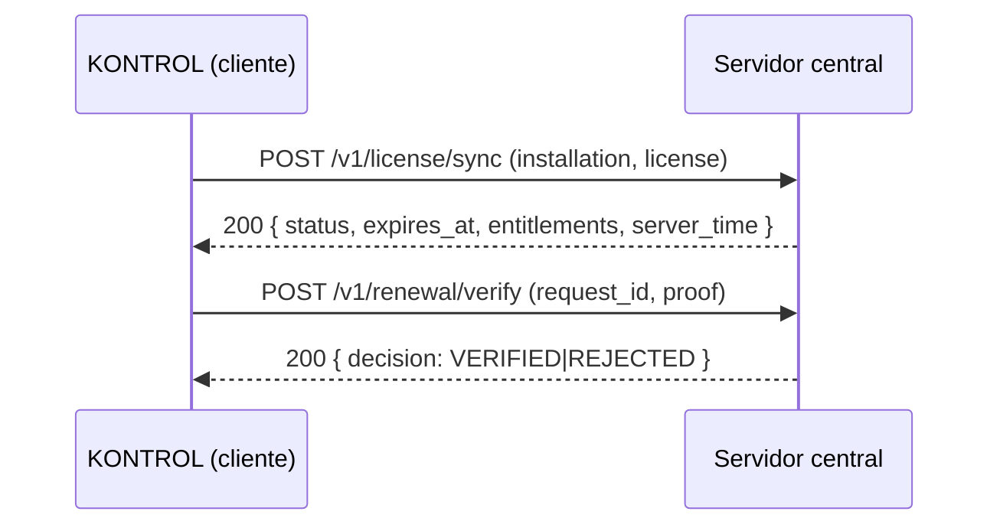

# CONTRATO DE API — LICENCIAMIENTO CENTRAL (v1)

| Campo | Valor |
|---|---|
| Iniciativa | 010-licenciamiento-central |
| Versión | 1.0 |
| Fecha | 2026-08-04 |
| Ruta | `specs/010-licenciamiento-central/contracts/api-contracts.md` |

> Este documento define el **contrato v1 del cliente** que KONTROL usa contra el servidor central de licencias. El servidor central real es un componente separado; en pruebas se usa un fake server conforme a este contrato (CL-010-02, SU-010-01).

## 1. Vista de alto nivel



## 2. Endpoints del servidor central (consumidos por el cliente)

### 2.1 Sincronización de licencia

`POST /v1/license/sync`

Request (v1):
```json
{
  "version": "1.0",
  "installation_id": "uuid",
  "license_jws": "string",
  "modules": ["ventas", "compras", "inventario", "tesoreria", "fiscal", "regulatorio", "reportes"]
}
```

Response 200:
```json
{
  "version": "1.0",
  "status": "FULL_ACCESS",
  "server_time": "2026-08-04T12:00:00Z",
  "expires_at": "2026-12-31T23:59:59Z",
  "entitlements": { "ventas": true, "compras": true, "inventario": true, "tesoreria": true, "fiscal": true, "regulatorio": true, "reportes": true }
}
```

### 2.2 Verificación de renovación

`POST /v1/renewal/verify`

Request (v1):
```json
{ "version": "1.0", "request_id": "uuid", "proof_reference": "string" }
```

Response 200:
```json
{ "version": "1.0", "decision": "VERIFIED" }
```
o
```json
{ "version": "1.0", "decision": "REJECTED", "reason": "string" }
```

## 3. Errores

| HTTP | Caso |
|---|---|
| 401 | Credencial/clave inválida |
| 409 | Licencia ya sincronizada (idempotencia) |
| 422 | Contrato v1 malformado |
| 503 | Servidor central no disponible (el cliente aplica gracia offline) |

## 4. Reglas del cliente

- Idempotente: reintentar la misma sincronización no duplica `license_sync_runs`.
- El `server_time` actualiza `last_reliable_date` (reloj confiable).
- `expires_at` + `grace_days` definen la gracia offline.
- Los `entitlements` se persisten como snapshot versionado.
