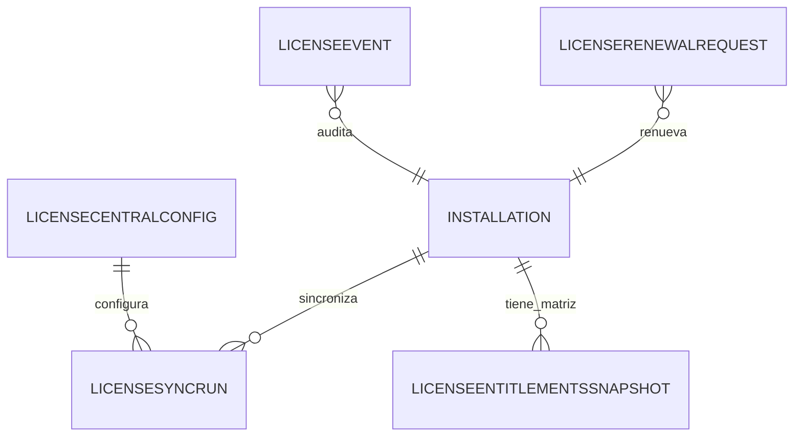

# MODELO DE DATOS — 010-LICENCIAMIENTO-CENTRAL

| Campo | Valor |
|---|---|
| Iniciativa | 010-licenciamiento-central |
| Versión | 1.0 |
| Fecha | 2026-08-04 |
| Ruta | `specs/010-licenciamiento-central/data-model.md` |

> Convenciones: `PK` clave primaria, `IX` índice, `JSON` campos estructurados (SQLite tests). Auditoría en todas las tablas.

## 1. Entidades nuevas (010)

| Tabla | Campos | Notas |
|---|---|---|
| `license_central_config` | PK id, server_url, public_key, sync_policy JSON, grace_days, enabled, status | FR-010-001 |
| `license_sync_runs` | PK id, installation_id, status (SUCCESS/FAILED), request JSON, response JSON, error, ran_at | FR-010-002/004 |
| `license_entitlement_snapshots` | PK id, installation_id, modules JSON (002-009 habilitados), version, taken_at | FR-010-010/012 |

## 2. Reutilización (001 — sin redefinir)

| Entidad | Uso en 010 |
|---|---|
| `LicenseState` | Estado/modo vigente (FULL_ACCESS…SECURITY_SUSPENSION) |
| `LicenseArtifact` | Artefacto JWS firmado (inalterable) |
| `LicenseEvent` | Auditoría de activación, sincronización, renovación y cambio de modo |
| `LicenseRenewalRequest` | Renovación con comprobante (workflow central) |
| `Installation` | Instalación del tenant (multi-instalación) |

## 3. Diagrama de relaciones (resumen)

## 4. Notas de diseño

- Artefactos y estado de licencia inalterables (P5); corrección por nueva emisión.
- La sincronización es idempotente y queda registrada (P5/ADR).
- Los entitlements se consultan en backend (seguridad por defecto).
- Offline grace con `last_reliable_date` y `grace_days` configurable.
