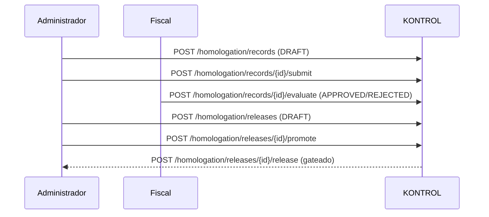

# CONTRATO DE API — HOMOLOGACIÓN Y LIBERACIÓN

| Campo | Valor |
|---|---|
| Iniciativa | 011-homologacion-liberacion |
| Versión | 1.0 |
| Fecha | 2026-08-04 |
| Ruta | `specs/011-homologacion-liberacion/contracts/api-contracts.md` |

> Define los endpoints `/homologation/*` (prefijo `/api/v1`). Reutiliza identidad de instalación y modo de licencia de 001.

## 1. Vista de alto nivel

## 2. Endpoints

### 2.1 Homologación

| Método/Ruta | Cuerpo | Respuesta |
|---|---|---|
| `POST /homologation/records` | `{fiscal_version, modality, formal_act_ref, evidence_sha256, notes}` | `{id, status: DRAFT, ...}` |
| `POST /homologation/records/{id}/submit` | — | `{id, status: SUBMITTED}` |
| `POST /homologation/records/{id}/evaluate` | `{decision: APPROVED\|REJECTED, formal_act_ref?, notes}` | `{id, status}` |
| `GET /homologation/records` | — | `{items, total}` |
| `GET /homologation/records/{id}` | — | Detalle + eventos |

### 2.2 Liberación

| Método/Ruta | Cuerpo | Respuesta |
|---|---|---|
| `POST /homologation/releases` | `{version, changelog, gates}` | `{id, status: DRAFT}` |
| `POST /homologation/releases/{id}/promote` | — | `{id, status: CANDIDATE}` |
| `POST /homologation/releases/{id}/release` | `{homologation_id?, notes}` | `{id, status: RELEASED\|BLOCKED, reasons[]}` |
| `GET /homologation/releases` | — | `{items, total}` |

### 2.3 Timeline

| Método/Ruta | Respuesta |
|---|---|
| `GET /homologation/timeline` | `{items:[{type, event_type, version?, created_by, created_at}]}` |

## 3. Errores

| HTTP | Caso |
|---|---|
| 403 | Segregación violada (creador = evaluador) o sin permiso |
| 409 | Transición inválida / re-liberación de versión anterior |
| 422 | Acto formal o versión fiscal ausente al declarar homologado |
| 423 | Licencia no permite liberar (modo != FULL_ACCESS) |

## 4. Reglas del servidor

- Eventos append-only; hash de evidencia validado.
- `HOMOLOGADO` es derivado: solo con `APPROVED` + acto formal (FR-011-005).
- Liberación exige homologación aprobada + gates verdes + licencia válida (FR-011-012).
