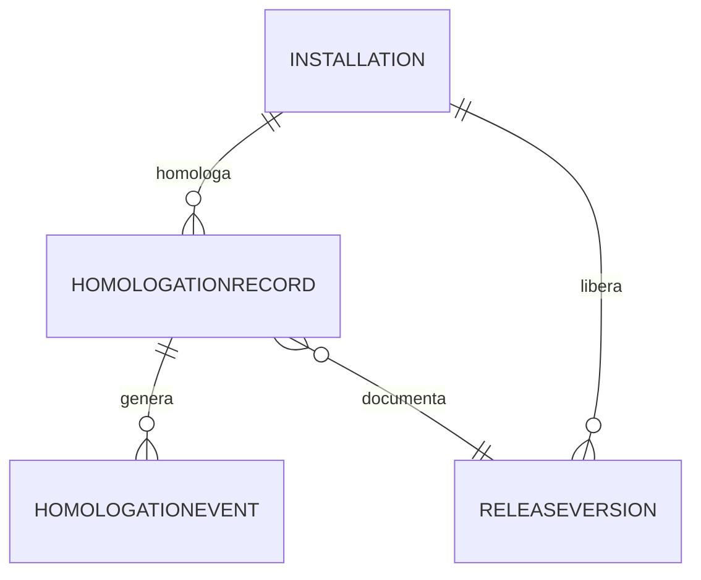

# MODELO DE DATOS — 011-HOMOLOGACION-LIBERACION

| Campo | Valor |
|---|---|
| Iniciativa | 011-homologacion-liberacion |
| Versión | 1.0 |
| Fecha | 2026-08-04 |
| Ruta | `specs/011-homologacion-liberacion/data-model.md` |

> Convenciones: `PK` clave primaria, `IX` índice, `JSON` campos estructurados. Auditoría en todas las tablas.

## 1. Entidades nuevas (011)

| Tabla | Campos | Notas |
|---|---|---|
| `homologation_records` | PK id, installation_id, fiscal_version, modality, formal_act_ref, evidence_sha256, status, evaluated_by, evaluated_at, notes | FR-011-001/002/003 |
| `homologation_events` | PK id, homologation_id, event_type, detail JSON, created_by, created_at | FR-011-004 (append-only) |
| `release_versions` | PK id, installation_id, version, changelog JSON, gates JSON, homologation_id FK, status, released_by, released_at, notes | FR-011-010/011/012/013 |

## 2. Reutilización (001 — sin redefinir)

| Entidad | Uso en 011 |
|---|---|
| `Installation` | Identidad de instalación (multi-instalación) |
| `LicenseState` / `current_mode` | Gate de liberación: requiere `FULL_ACCESS` |
| `AuditEvent` (001) | Complemento de auditoría global (reutilizable en timeline) |

## 3. Diagrama de relaciones (resumen)

## 4. Notas de diseño

- `evidence_sha256` valida integridad del acto formal/documento (FR-011-100).
- Eventos append-only con `event_type` y `created_by` (trazabilidad y conservación).
- `gates` (JSON) registra cada gate con resultado, responsable y fecha.
- `status` de homologación: `HOMOLOGADO` es una derivación solo válida si `APPROVED` + acto formal (FR-011-005).
