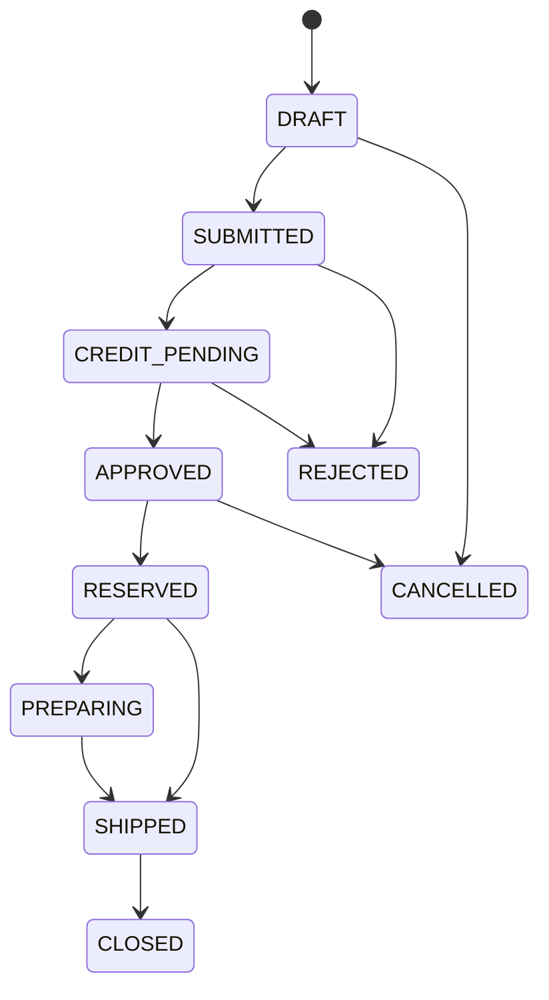

# Auditoría de Máquinas de Estado — Spec 012 (pasada 2)

> Cada entidad/transacción declara una máquina explícita (`*_TRANSITIONS`) y se valida con `_assert_transition` en el servicio (backend = autoridad). Verificado por inspección de código + E2E (transiciones ejecutadas en el flujo completo).

## Ventas (`sales/service.py`)

### Orden de venta (`ORDER_TRANSITIONS`)

E2E ejecutado: SUBMITTED → CREDIT_PENDING → APPROVED → RESERVED ✅

### Factura de venta (`INVOICE_TRANSITIONS`)
`DRAFT → VALIDATED → APPROVED → EMITTED → {DELIVERED, PARTIALLY_PAID, PAID, CREDITED, VOIDED}`.
E2E: VALIDATED → APPROVED → EMITTED ✅ (genera CxC).

## Compras (`purchasing/service.py`)

- **Requisición**: `DRAFT → SUBMITTED → APPROVED → CLOSED` (+ CANCELLED/REJECTED terminales).
- **Orden de compra**: `DRAFT → SUBMITTED → APPROVED → {PARTIALLY_RECEIVED, RECEIVED} → CLOSED`. E2E: SUBMITTED → APPROVED ✅
- **Recepción**: `DRAFT → CONFIRMED → QUALITY_PENDING → {ACCEPTED, PARTIALLY_ACCEPTED, REJECTED} → CLOSED`. E2E: CONFIRMED→QUALITY_PENDING→ACCEPTED ✅
- **Factura proveedor**: `DRAFT → VALIDATED → {MATCHED, EXCEPTION} → APPROVED → POSTED → {PARTIALLY_PAID, PAID, REVERSED}`. E2E: VALIDATED→MATCHED→APPROVED→POSTED ✅
- **Pago**: `DRAFT → SUBMITTED → APPROVED → POSTED`. E2E ✅
- **Retención**: `CALCULADA → PRACTICADA → EMITIDA → DECLARADA → PAGADA → CONCILIADA` (+ REVERSADA).

## Inventario (`inventory/service.py`)

- **Transferencia**: `DRAFT → SUBMITTED → APPROVED → PICKING → IN_TRANSIT → {PARTIALLY_RECEIVED, RECEIVED} → CLOSED`. E2E: APPROVED→PICKING→IN_TRANSIT→RECEIVED ✅
- **Conteo**: `DRAFT → FROZEN → COUNTING → SUBMITTED → APPROVED → CLOSED`.
- **Ajuste**: `DRAFT → SUBMITTED → APPROVED → APPLIED`.
- **Lote/Serial**: `DISPONIBLE → {RESERVADO, TRANSITO, CUARENTENA}`; `RESERVADO → {DISPONIBLE, TRANSITO, VENDIDO}`; `CUARENTENA → {DISPONIBLE, RECHAZADO, DESECHO}`; `VENCIDO/RECHAZADO → DESECHO`.

## Tesorería (`treasury/service.py`)

- **Sesión de caja** (`CASH_SESSION_TRANSITIONS`): OPEN → ARCHED/PRE_CLOSED → ... → CLOSED (REJECTED).
- **Conciliación** (`RECONCILIATION_TRANSITIONS`).

## Fiscal (`fiscal/service.py`)

- **Período fiscal** (`PERIOD_TRANSITIONS`): OPEN → ... → CLOSED (con `_assert_transition`).
- Documentos fiscales: emisión consume correlativo + número de control en transacción atómica (hash de integridad; inmutables; corrección vía NC/ND/anulación/reverso).

## Regulatorio (`regulatory/service.py`)

- **Permiso/guía** (`PERMIT_TRANSITIONS`) y **Solicitud de aprobación** (`APPROVAL_TRANSITIONS`: PENDING → APPROVED/REJECTED). E2E de aprobaciones ✅ (pasada previa 3/3).

## Licenciamiento (`licensing/service.py`)

- **Modos** (`MODE_TRANSITIONS`): FULL_ACCESS ↔ RENEWAL_NOTICE ↔ CRITICAL_RENEWAL_NOTICE ↔ READ_ONLY (con `transition_mode`).
- **Renovación** (`RENEWAL_TRANSITIONS`).

## Homologación (`homologation/service.py`)

- **Homologación** (`HOMOLOGATION_TRANSITIONS`) y **Liberación de versión** (`RELEASE_TRANSITIONS`: DRAFT → CANDIDATE → RELEASED).

## Cumplimiento

| Aspecto | Estado |
|---|---|
| Máquina explícita por entidad | ✅ (todas) |
| Backend enforcement (`_assert_transition` → 409 CONFLICT) | ✅ |
| Permiso por transición (require_permission) | ✅ (crear/aprobar/transition) |
| Auditoría de transición | ❌ **No** (KAUD-001: no se emite AuditEvent al transicionar) |
| DB enforcement (CHECK constraints) | Parcial — verificar en PostgreSQL (SQLite no valida igual) |
| Prueba de transiciones inválidas | Parcial — cubiertas por tests de módulo; falta matriz exhaustiva |

**Riesgo:** al no auditarse las transiciones (KAUD-001), no queda rastro de quién movió un documento de estado ni cuándo.
